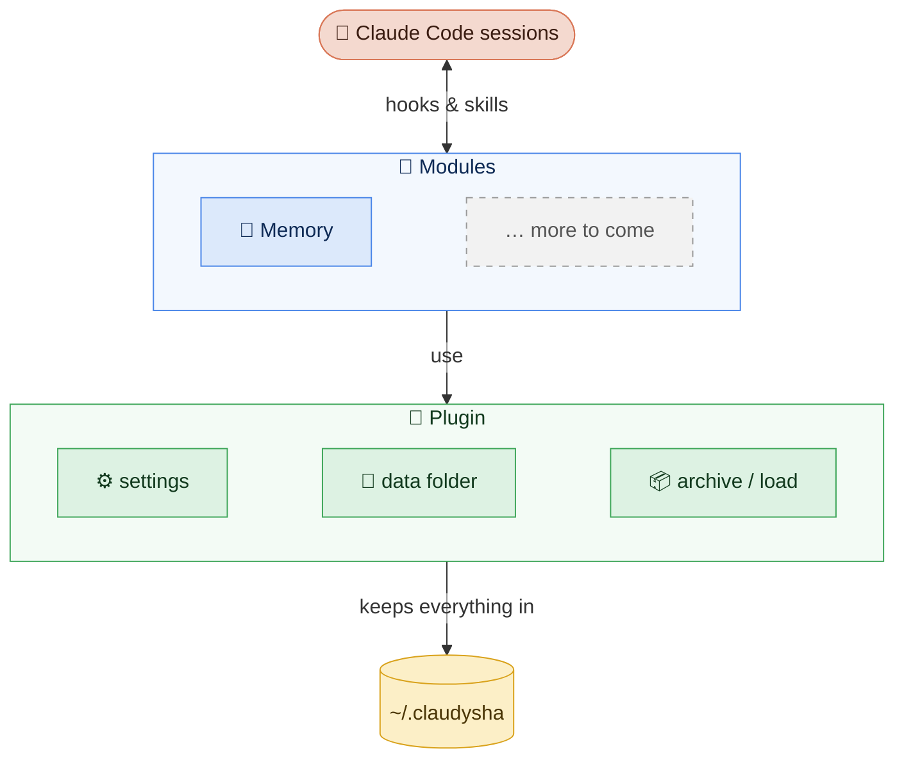
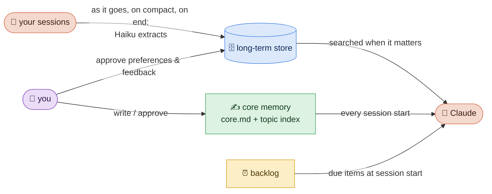

<div align="center">

# 🧠 claudysha

**A personal plugin for [Claude Code](https://code.claude.com)**<br>
*one that grows into* your *Claude, session after session*


</div>

---

### ✨ What "personal" means

**Personal to whoever uses it.** It isn't one person's setup to copy: every install starts out generic and becomes personal to its own user as it learns from their sessions: what they work on, the decisions they made and why, how they like Claude to work with them.

> Two people using claudysha end up with two different Claudes, each shaped by its own user's habits.

That knowledge stays in the user's data folder, on their machine, and the parts that change how Claude behaves only change with their OK.

### 🧩 How it's built

claudysha has two layers: **the plugin**, which provides what every module shares, and **modules**, which add the actual features.



- **The plugin**: installation, settings, one data folder for everything, archive / load of that folder.
- **Modules**: each lives in its own folder, keeps its data in its own part of the data folder, and plugs into Claude Code through hooks and skills.
    - 🧠 **[Memory](#memory-module)**: automatic long-term store, core memory, backlog.

No server, no external database, no dependencies: Python's standard library (3.12+, with SQLite FTS5).

---

# 🔌 The plugin

## 🚀 Install

**The easy way: ask Claude to install it ;)**

> Install the claudysha plugin from https://github.com/Nevysha/claudysha for me.

Claude clones it, asks you the few setup questions in the chat, and runs the installer (the repo's `CLAUDE.md` tells it how).

**By hand,** from a clone:

```
git clone https://github.com/Nevysha/claudysha.git ~/claudysha
~/claudysha/install.sh            # asks a few questions, then installs claudysha@nevysha for your user
~/claudysha/install.sh --remove   # uninstalls; your data stays
```

`install.sh`:

1. writes the settings file if it doesn't exist (in a terminal it asks for the data folder, your name, your pronouns and your projects; otherwise it uses the defaults),
2. creates the data folder, and lets each module create its part,
3. registers the repo as a local marketplace (`nevysha`) and installs the plugin.

Claude Code runs a cached copy of the plugin, made for its version (`version` in `.claude-plugin/plugin.json`). After pulling or editing, run `./install.sh` again: it refreshes the copy when the version changed. New sessions (or `/reload-plugins`) then use it.

**From Claude Code's plugin manager:** `/plugin marketplace add Nevysha/claudysha`, then `/plugin install claudysha@nevysha`. The data folder is created at the first session start, which also suggests running `claudysha setup` to write the settings.

## ⚙️ Settings

`~/.config/claudysha/claudysha.conf` (or `$XDG_CONFIG_HOME/claudysha/claudysha.conf`, or `CLAUDYSHA_CONFIG`). It lives outside the plugin folder on purpose: a plugin installed from GitHub is a cached copy that's replaced on updates. `claudysha.conf.example` documents it; `./claudysha config` shows the file in use and the settings in effect.

| Key | Default | Used by | What |
|---|---|---|---|
| `home` | `~/.claudysha` | plugin | the data folder (`CLAUDYSHA_HOME` overrides it) |
| `user_name` | `the user` | modules | how Claude refers to you |
| `user_pronouns` | `they/them` | modules | your pronouns |
| `projects` | (none) | Memory | comma-separated projects to file memories under |

## 📁 Data folder

Everything claudysha keeps lives in one folder, never in the plugin itself. Each module owns its part:

```
~/.claudysha/
  brain/      Memory module: hand-written notes (its own git repo)
  memory/     Memory module: long-term store
  backups/    yours: anything you want archived with the rest
```

## 📦 Archive and load

```
./claudysha archive [file-or-folder]   # .tar.gz of the whole data folder
./claudysha load <archive>             # replace the whole data folder with an archive
```

- The archive covers every module. SQLite databases are copied consistently even while being written, and a `claudysha-archive.json` manifest identifies the archive.
- `load` erases everything that isn't in the archive. It lists what would be erased and only proceeds when you **type `erase` in a terminal**. It refuses piped input, which stops accidental or scripted confirmations; a program could still fake a terminal, so the rest is a rule: Claude must never confirm a load for you. Before replacing anything it saves the current folder next to it (`~/.claudysha-before-load-<date>.tar.gz`). It rejects archives with absolute or `..` paths, links, or no manifest.
- Modules that write in the background take a shared lock on the data folder, and `load` an exclusive one, so they never overlap.

## 🧩 How modules plug in

A module is a folder with:

- an `init()` (registered in `MODULES` in `plugin/claudysha.py`) that creates its part of the data folder without overwriting anything,
- its hooks in `hooks/hooks.json` and its skills in `skills/`,
- its own tests in `<module>/tests/`.

Modules read the settings and the data folder path through `plugin/claudysha.py`. The plugin's own SessionStart hook (`claudysha session-start`) runs first and makes sure the data folder exists.

---

<a id="memory-module"></a>

# 🧠 Memory module

Gives Claude a memory that carries across sessions.



It has three parts:

| Part | What | Data | In sessions |
|---|---|---|---|
| 🗄️ [Long-term store](#long-term-store) | facts, decisions, dead ends... extracted automatically from every session | `memory/memory.db` | searched on demand (`claudysha:recall` skill) |
| ✍️ [Core memory](#core-memory) | who you are, how you want Claude to work with you, an index of topic notes | `brain/core.md`, `brain/memories/` | printed into every session |
| ⏰ [Backlog](#backlog) | postponed ideas with a review date | `brain/maybe-later/` | due items listed at session start |

The split matters: the long-term store can capture generously because it's never loaded wholesale, while the core, which shapes how Claude behaves, stays small and only changes with your OK. `brain/` is a git repo, so every change to the hand-written notes has a history.

<a id="long-term-store"></a>

## 🗄️ Long-term store

As a session goes on (every few hundred transcript lines), when it compacts and when it ends, a small model (Haiku) reads the transcript and extracts memories into a local SQLite database. Claude searches it when the topic calls for it.

### Entries

Each memory has `text`, `type`, `project`, `tags`, `confidence` (0 to 1), `status`, `superseded_by`, `source` (`manual` or `extract`), `session_id`, `created_at` (when the conversation happened), `last_used_at`, `use_count` and a JSON `meta`.

- Types: `fact`, `decision`, `dead_end`, `event`, `todo`, `preference`, `feedback`.
- Statuses: `active`, `proposed`, `superseded`, `rejected`. Extracted `preference` and `feedback` entries shape how Claude behaves, so they stay `proposed` until you approve them: `mem review` in a terminal (one at a time, single keys), or `/claudysha:memory-review` in a session.

### Why SQLite

One file, no server. Tables cover metadata and filtering, JSON columns cover free-form data, and FTS5 covers keyword search. It handles exact tokens like `127.0.0.1:8080` or `pnpm@10.15.1` well (each search term is quoted as a phrase), which embeddings are weak at. Search by meaning can be added later with the `sqlite-vec` extension in the same file.

### Extraction

Three hooks run `mem hook`: SessionEnd, PreCompact, and Stop (after each of Claude's replies). For Stop, it first counts the transcript lines not extracted yet and does nothing until there are `memory_every_lines` of them (300 by default, `0` turns it off), so a long session is saved as it goes. Then it starts `mem ingest --hook` in the background so the session never waits. It:

1. reads the transcript from where the last run stopped,
2. skips sessions you never typed in (`claude -p` runs from scripts have no message with `origin.kind == "human"`),
3. condenses it to the dialogue plus short tool hints (no tool output, no thinking); user-role messages that aren't yours (task notifications, summaries) are labelled as notes,
4. asks Haiku (`claude -p --model haiku`, structured output, `memory/store/prompts/extract.md`) for memories,
5. sends each candidate with its closest stored memories to a second call (`memory/store/prompts/resolve.md`) that marks duplicates and memories it makes obsolete,
6. stores the rest and supersedes the obsolete ones.

Child `claude -p` runs set `MEM_NO_HOOK=1` and load no settings, so they never trigger extraction themselves. `MEM_EXTRACT_MODEL` overrides the model. It costs well under a cent per extraction run.

### Commands

```
mem search <words...> [-p project] [-t type] [-a] [-f]   # OR-ed terms, ranked by bm25, confidence, use
mem add "<text>" [-t type] [-p project] [--tags ...] [-c 0.9]
mem get <id...>
mem list [-p project] [-t type] [-n 20]
mem supersede <id> "<new text>"  |  mem supersede <id> --by <id>
mem edit <id> [--text ...] [-t ...] [-p ...] [--tags ...] [-c ...]
mem review [-l]                   # one by one: a approve, r reject, e edit, t type, s skip, u undo (-l: list)
mem approve <id...>  |  mem reject <id...>
mem ingest <transcript.jsonl> [--dry-run]
mem backfill [--project-dir <folder under ~/.claude/projects>]
mem stats  |  mem export          # JSONL dump
```

<a id="core-memory"></a>

## ✍️ Core memory

`brain/core.md` holds who you are and how you want Claude to work with you; `brain/memories/` holds one note per topic, indexed in `brain/memories/MEMORY.md`. At session start (and again after a compaction), `memory/core.py` prints `core.md` and the index into the session, so they shape every session. You write these files (or approve Claude's edits); keep `core.md` short.

<a id="backlog"></a>

## ⏰ Backlog

One note per postponed idea in `brain/maybe-later/`, starting with:

```yaml
---
status: open          # open | waiting | someday | done
created: 2026-11-13
review-after: 2026-11-27   # empty = no date
summary: one line
---
```

At session start, `memory/backlog.py` lists the open or waiting notes whose `review-after` date has passed, so postponed work comes back on its own. `memory/backlog.py list` shows them all.

## 🪝 What the module adds to a session

| Piece | Part |
|---|---|
| SessionStart: `memory/core.py session-start` | core memory |
| SessionStart: `mem session-start` (a line saying the store exists, and how many memories wait for review) | long-term store |
| SessionStart: `memory/backlog.py session-start` | backlog |
| SessionEnd, PreCompact and Stop: `mem hook` (Stop only every `memory_every_lines` new transcript lines) | long-term store |
| `claudysha:recall` skill: how to search, save and correct memories | long-term store |
| `/claudysha:memory-review` skill: review proposed memories in the chat | long-term store |

## 🛣️ Not done yet

- A consolidation pass that proposes promotions from the store to the core, merges, and expiry of stale todos.
- Meaning search with `sqlite-vec`, if keyword search starts missing things.

---

# 🗺️ Repository layout

| Path | What |
|---|---|
| `.claude-plugin/` | plugin manifest (`claudysha`) and the marketplace that lists it (`nevysha`) |
| `plugin/` | the plugin: settings, data folder, setup, archive/load (`claudysha` is a symlink to `plugin/claudysha.py`) |
| `memory/` | the Memory module: `core.py` (its folders, core memory), `backlog.py`, `store/` (long-term store: `mem.py`, `review.py`, `prompts/`; `mem` is a symlink to `store/mem.py`) |
| `hooks/hooks.json`, `skills/` | what the plugin and its modules add to sessions |
| `install.sh`, `claudysha.conf.example` | installation and settings reference |

## 🧪 Tests

```
python3 -m unittest discover -s plugin/tests
python3 -m unittest discover -s memory/tests
```

Standard library only; model calls are mocked. Scheduled archives and an off-machine copy are not done yet.

## 📜 License

MIT, see `LICENSE`.
